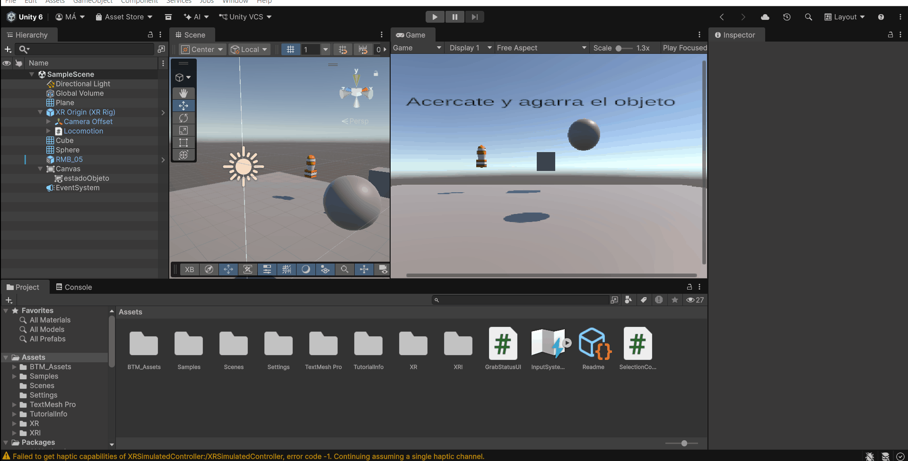

# Práctica XR — Interfaces Inteligentes

## Interacción con objetos mediante mandos simulados

Esta práctica introduce el uso de XR Interaction Toolkit y OpenXR en Unity. La escena permite seleccionar y agarrar objetos con mandos simulados, cambiar el color de dos figuras geométricas y actualizar una interfaz al interactuar con un modelo de la Asset Store.

El desarrollo se ha realizado en Windows mediante el simulador del propio XR Interaction Toolkit. Se ha utilizado la alternativa de simulación genérica permitida en el enunciado, sin instalar Meta XR Simulator externo ni el SDK de Meta.

## Ejercicio 1. Instalación y configuración del proyecto XR

**Enunciado:** Instalar XR Plug-in Management, OpenXR Plugin y XR Interaction Toolkit, importar Starter Assets y configurar una alternativa de simulación para realizar la práctica.

**Archivos y configuración:** `Packages/manifest.json`, `Assets/XR` y `Assets/XRI/Settings`.

**Descripción de lo realizado:**

Se ha creado un proyecto independiente del de Cardboard, con Unity 6.6 y Universal Render Pipeline (URP). Se han instalado los paquetes XR desde Package Manager y se han importado las muestras Starter Assets y XR Interaction Simulator.

| Componente | Versión |
|---|---|
| Unity Editor | `6000.6.3f1` |
| XR Interaction Toolkit | `3.6.1` |
| XR Plug-in Management | `4.7.0` |
| OpenXR Plugin | `1.18.0` |
| Input System | `1.20.0` |
| Universal Render Pipeline | `17.6.0` |

En la configuración OpenXR de Standalone se han habilitado los perfiles Oculus Touch Controller y Meta Quest Touch Plus Controller. Para las pruebas sin gafas se ha desactivado `Initialize XR on Startup` en Standalone, evitando intentar iniciar un runtime OpenXR externo al entrar en Play.

El simulador de XRI se activa mediante `Use XR Interaction Simulator in scenes`, con instanciación únicamente en el editor. La opción del simulador clásico permanece desactivada. Esta configuración crea el simulador automáticamente al comenzar la ejecución, sin necesidad de incorporar una segunda copia a la escena.

Los perfiles de mandos no equivalen a instalar Meta XR Simulator: identifican los dispositivos compatibles con OpenXR. En esta práctica las entradas de prueba las proporciona XR Interaction Simulator.

## Ejercicio 2. Preparación de la escena y del jugador

**Enunciado:** Eliminar la cámara inicial, añadir un XR Origin de Starter Assets y colocar sobre un plano un cubo, una esfera y un objeto de la Asset Store a diferentes distancias.

**Archivo:** `Assets/Scenes/SampleScene.unity`.

**Descripción de lo realizado:**

Se ha eliminado la Main Camera original y se ha añadido el prefab `XR Origin (XR Rig)` de Starter Assets. El rig contiene su propia cámara, el desplazamiento relativo del seguimiento y los controladores izquierdo y derecho con sus configuraciones de entrada e interacción.

La escena incluye un plano de apoyo, iluminación direccional, un Global Volume, el cubo, la esfera, el modelo externo y una interfaz de texto. Los objetos se han colocado en posiciones distintas para experimentar con la selección y el agarre a diferentes distancias.

Los tres objetos interactuables disponen de collider, Rigidbody y XR Grab Interactable. En la escena guardada sus Rigidbody tienen gravedad activada y no son cinemáticos, de modo que participan en la simulación física. El plano proporciona la superficie de apoyo mediante su collider.

| Componente | Función |
|---|---|
| Collider | Define la geometría detectable y los contactos físicos |
| Rigidbody | Permite que el objeto responda a la física |
| XR Grab Interactable | Registra el objeto como agarrable en el sistema XR |
| XR Origin | Organiza la cámara, los mandos y el espacio del jugador |

Los interactores pertenecen a los mandos; los objetos de la escena son los interactuables que reciben las interacciones.

## Ejercicio 3. Cambio de color del cubo y la esfera

**Enunciado:** Permitir la selección a distancia del cubo y de la esfera y cambiar su color al seleccionarlos.

**Archivo:** [SelectionColor.cs](Assets/SelectionColor.cs).

**Descripción de lo realizado:**

Se ha añadido `SelectionColor` al cubo y a la esfera. En `Awake()` el script obtiene una instancia del material de su Renderer y almacena su color inicial. Utiliza `_BaseColor` cuando el material dispone de esa propiedad y, como alternativa, `_Color`.

Cada objeto conecta sus eventos de XR Grab Interactable con sus propios métodos:

| Evento | Método | Resultado |
|---|---|---|
| Select Entered | `SelectionColor.Select()` | Aplica el color de selección configurado |
| Select Exited | `SelectionColor.Deselect()` | Recupera el color original |

El cambio ocurre al seleccionar, no simplemente al apuntar. La instancia de material permite modificar cada figura de forma independiente y se destruye al eliminar el componente u objeto.

Durante el desarrollo se ha comprobado el funcionamiento de la selección y de la restauración del color con los mandos simulados.

## Ejercicio 4. Objeto de la Asset Store y actualización de la UI

**Enunciado:** Incorporar un objeto externo que actualice una interfaz al agarrarlo mediante interacción directa.

**Archivo:** [GrabStatusUI.cs](Assets/GrabStatusUI.cs).

**Descripción de lo realizado:**

Se ha incorporado el prefab `RMB_05` del paquete Rockets, Missiles and Bombs, ubicado en `Assets/BTM_Assets/BTM_Rockets_Missiles_Bombs`. En el componente de interfaz se ha configurado el nombre visible `Little Boy`.

El objeto dispone de XR Grab Interactable y de `GrabStatusUI`. Este último mantiene una referencia a un texto TextMeshPro y un contador de agarres. Los eventos se han conectado de la siguiente forma:

| Evento | Método | Actualización |
|---|---|---|
| Select Entered | `GrabStatusUI.OnGrab()` | Incrementa el contador y muestra el objeto agarrado |
| Select Exited | `GrabStatusUI.OnRelease()` | Muestra que se ha soltado y conserva el contador |

El campo `objectName` representa el nombre que se muestra al usuario y no necesita coincidir con el de la Hierarchy. El contador se mantiene durante la ejecución y no se guarda entre sesiones.

La interfaz utiliza el objeto `estadoObjeto`, con un mensaje inicial que invita a acercarse y agarrar el modelo. En la escena guardada, el Canvas está configurado como Screen Space - Overlay, adecuado para visualizar el estado durante la simulación en Game. Para su uso en un visor real habría que adaptar y comprobar la presentación, por ejemplo mediante un Canvas World Space.

### Alcance actual de los interactores

El prefab de Starter Assets de XRI 3.6.1 conserva los **Near-Far Interactors**, capaces de realizar interacciones cercanas y lejanas. Los tres objetos comparten la capa de interacción `Default`.

Por tanto, la versión guardada no impone que el objeto externo solo se pueda agarrar por contacto y no contiene una configuración dedicada de XR Direct Interactor para ese modelo. Tampoco debe confundirse el rayo de teletransporte del rig con el interactor utilizado para seleccionar los objetos.

Para cumplir literalmente la separación solicitada en el enunciado queda configurar XR Ray Interactor para las figuras y XR Direct Interactor para el modelo externo, con capas de interacción diferenciadas. El Direct Interactor necesita un volumen trigger en el mando y una entrada de selección configurada. Los eventos de color y de UI pueden conservarse al realizar ese ajuste.

## Simulación y controles

El simulador se encuentra en:

```text
Assets/Samples/XR Interaction Toolkit/3.6.1/XR Interaction Simulator
```

Starter Assets y el prefab del jugador se encuentran en:

```text
Assets/Samples/XR Interaction Toolkit/3.6.1/Starter Assets
```

Para probar la escena:

1. Abrir `Assets/Scenes/SampleScene.unity`.
2. Comprobar que la instanciación automática del simulador está activada.
3. Pulsar Play y dar el foco a la ventana Game.
4. Utilizar la interfaz de ayuda del simulador para seleccionar el modo y el dispositivo controlado.
5. Apuntar a una figura y activar la acción de agarre/selección. Comprobar el cambio de color y su restauración al soltar.
6. Agarrar el objeto externo y comprobar los mensajes y el contador de la interfaz.

| Control | Función |
|---|---|
| Tab | Alterna entre modo FPS y modo de dispositivos |
| `[` | Selecciona el controlador izquierdo |
| `]` | Selecciona el controlador derecho |
| WASD | Desplaza el elemento controlado según el modo activo |
| Acciones indicadas por la ayuda | Orientación, agarre y botones del mando simulado |

Al seleccionar un mando en modo de dispositivos, el teclado y el ratón pasan a manipularlo independientemente de la cámara. Este comportamiento permite simular el movimiento de una mano sin desplazar la cabeza; no indica una desconexión del mando.

Los controles de esta muestra no son los del Meta XR Simulator externo. Si el teclado dificulta el uso de los corchetes, las asignaciones pueden consultarse y modificarse en los Input Action Assets de la muestra.

## Organización del proyecto

```text
Assets/
├── Scenes/
│   └── SampleScene.unity
├── SelectionColor.cs
├── GrabStatusUI.cs
├── BTM_Assets/
│   └── BTM_Rockets_Missiles_Bombs/
├── Samples/
│   └── XR Interaction Toolkit/3.6.1/
│       ├── Starter Assets/
│       └── XR Interaction Simulator/
├── XR/
└── XRI/
```

## Comprobaciones y estado de la práctica

Se ha puesto en funcionamiento el simulador genérico, se ha confirmado la aparición de los mandos y sus rayos, y se ha probado la selección y deselección de las figuras. La escena también contiene los eventos de actualización de la UI conectados al modelo externo.

La revisión de los archivos confirma la configuración y las referencias guardadas; no sustituye una nueva prueba de ejecución. Debe comprobarse el contador al agarrar y soltar el modelo y completar la separación Ray/Direct indicada anteriormente.

No se ha utilizado un visor Quest físico ni se ha validado una compilación para Quest. La plataforma Android no tiene un cargador XR asignado en la configuración guardada, por lo que sería necesario configurarla antes de generar y probar esa versión. La simulación automática está limitada al editor y no equivale a un simulador incluido en una aplicación compilada.

## Referencias

- [Starter Assets de XR Interaction Toolkit 3.6](https://docs.unity3d.com/Packages/com.unity.xr.interaction.toolkit@3.6/manual/samples-starter-assets.html).
- [XR Interaction Simulator](https://docs.unity3d.com/Packages/com.unity.xr.interaction.toolkit@3.6/manual/xr-interaction-simulator-overview.html).
- [XR Direct Interactor](https://docs.unity3d.com/Packages/com.unity.xr.interaction.toolkit@3.6/manual/xr-direct-interactor.html).

El modelo externo y los recursos de las muestras mantienen sus respectivas licencias.

## Demostración de la práctica


