# Practica 2 Interfaces Inteligentes

## Ejercicios scripts: 5-13

### Ejercicio 5

**Enunciado:** Selecciona tres posiciones en tu escena a través de un objeto invisible (marcador) que incluya 3 vectores numéricos para configurar posiciones en las que quieres ubicar los objetos en respuesta a pulsar la barra espaciadora. Estos vectores representan un desplazamiento respecto a la posición original de cada objeto. Crea un script que ubique en las posiciones configuradas cuando el usuario pulse la barra espaciadora.

**Archivo:** movimientoCubo.cs, movimientoEsfera.cs, movimientoCapsula.cs

**Descripción de lo realizado:**

Se han creado tres primitivas 3D en la escena: un cubo, una esfera y una cápsula. A cada figura se le ha asociado un script independiente que utiliza el método GameObject.Find() para localizar su marcador correspondiente (objetos vacíos previamente posicionados). Mediante la lectura del teclado con Input.GetAxis("Jump"), se detecta la pulsación de la barra espaciadora, momento en el cual los objetos se trasladan a la posición de sus marcadores sumando un vector de desplazamiento configurable.

**Gif de demostracion:**
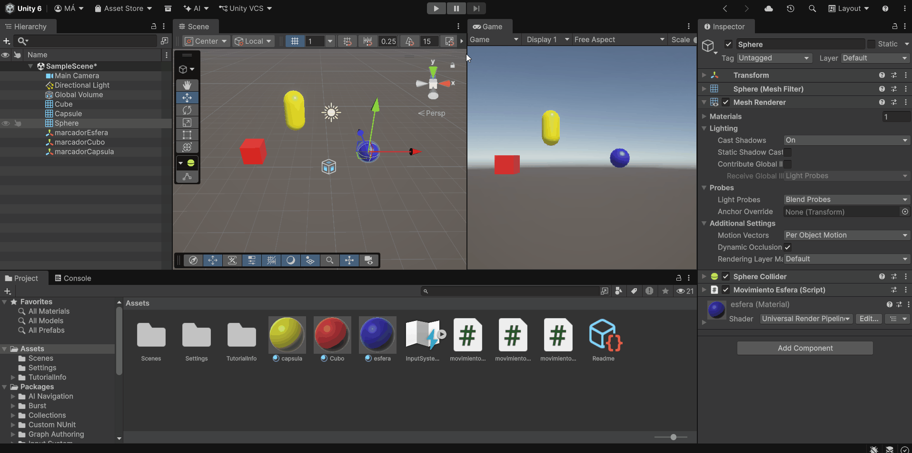

### Ejercicio 6

**Enunciado:** Agrega un campo velocidad a un cubo y asígnale un valor que se pueda cambiar en el inspector de objetos. Muestra la consola el resultado de multiplicar la velocidad por el valor del eje vertical y por el valor del eje horizontal cada vez que se pulsan las teclas flecha arriba-abajo ó flecha izquierda-derecha. El mensaje debe comenzar por el nombre de la flecha pulsada.

**Archivo:**  campoVelocidad.cs

**Descripción de lo realizado:**

Se ha creado un script asociado a un cubo que expone una variable pública velocidad modificable desde el Inspector. En el bucle principal, se monitoriza la pulsación de las flechas direccionales mediante `Input.GetKey()`. Al detectar una pulsación, se multiplica la velocidad por el valor del eje correspondiente utilizando `Input.GetAxisRaw()` (si usaramos `Input.GetAxis()` se aplica un suavidado que activaria la funcion varios frames, con Raw al final nos quedamos con el valor 0 o 1), e imprime el resultado final en la consola indicando la tecla exacta que fue accionada.

**Gif de demostracion:**
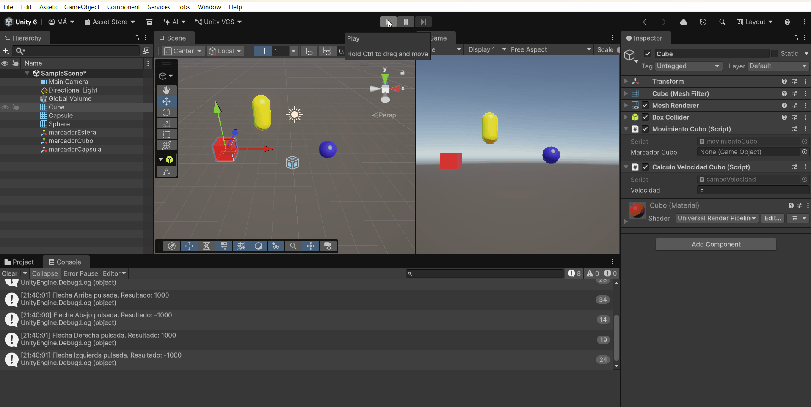

### Ejercicio 7

**Enunciado:** Mapea la tecla H a la función disparo.

**Archivo:** No hay archivo, se utilizó los ajustes del proyecto

**Descripción de lo realizado:**

Nos dirigimos a Edit > Project Settings y accedemos a la sección Input Manager. Localizamos el eje Fire1, abrimos su menú desplegable y cambiamos el valor del campo Positive Button asignándole la tecla `h`.

**Gif de demostracion:**
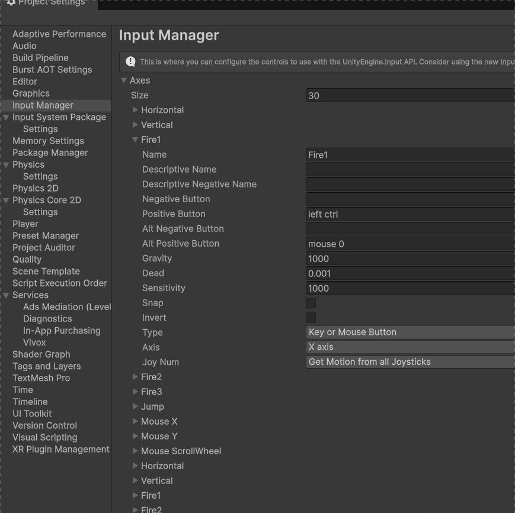

### Ejericio 8

**Enunciado:** Crea un script asociado al cubo que en cada iteración traslade al cubo una cantidad proporcional un vector que indica la dirección del movimiento: moveDirection que debe poder modificarse en el inspector.  La velocidad a la que se produce el movimiento también se especifica en el inspector, con la propiedad speed. Inicialmente la velocidad debe ser mayor que 1 y el cubo estar en una posición y=0.

**Archivo:** No hay archivo, se utilizó los ajustes del proyecto

**Descripción de lo realizado:**

En el informe de la práctica comenta los resultados que obtienes en cada una de las siguientes situaciones:

- duplicas las coordenadas de la dirección del movimiento.
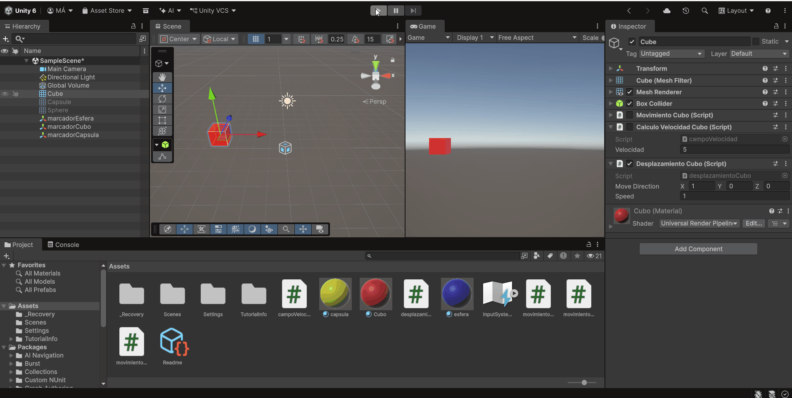

- duplicas la velocidad manteniendo la direccion de movimiento
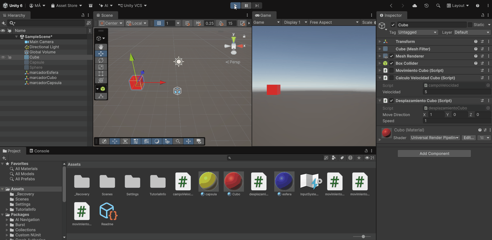

- la velocidad que usas es menor que 1

- la posición del cubo es y > 0
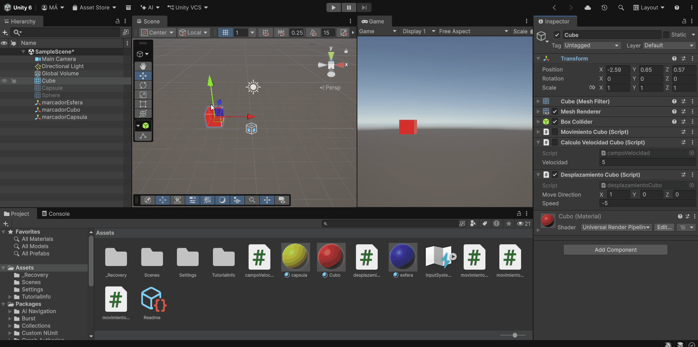

- intercambiar movimiento relativo al sistema de referencia local y el mundial.
Al no estar rotado el cubo, no hay ninguna diferencia entre propio eje del cubo y el mundial, por lo que el movimiento será el mismo. Para notar alguna diferencia, habría que aplicar un mínimo de rotación al cubo y así el eje local del mismo y el ojo global no coincidiría.

### Ejercicio 9

**Enunciado:** Mueve el cubo con las teclas de flecha arriba-abajo, izquierda-derecha a la velocidad speed. Cada uno de estos ejes implican desplazamientos en el eje vertical y horizontal respectivamente. Mueve la esfera con las teclas w-s (movimiento vertical) a-d (movimiento horizontal).

**Archivo:** movimientoFlechas.cs y movimientoWASD.cs

**Descripción de lo realizado:**
Podríamos haber utilizado `Input.GetAxis()` para controlar el movimiento de ambos objetos. Sin embargo, los ejes "Horizontal" y "Vertical" responden tanto a las teclas de dirección como a WASD, por lo que el cubo y la esfera reaccionarían a ambos controles. Para evitarlo, se utiliza `Input.GetKey()` junto con `KeyCode`, asignando a cada objeto únicamente las teclas que le corresponden, por ejemplo `KeyCode.A` para la esfera o `KeyCode.LeftArrow` para el cubo.
Además, en el GIF se puede observar el efecto de no escalar el desplazamiento mediante `Time.deltaTime`. En ese caso, el valor de speed se aplica en cada fotograma, por lo que la velocidad final depende de la cantidad de FPS y resulta excesivamente alta incluso con `speed = 1`.

**Gif de demostracion:**
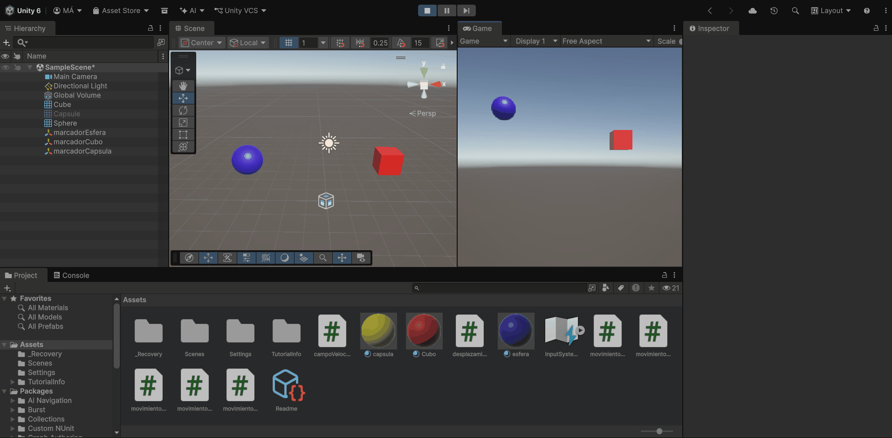

### Ejercicio 10

**Enunciado:** Adapta el movimiento en el ejercicio 9 para que sea proporcional al tiempo transcurrido durante la generación del frame.

**Archivo:** movimientoFlechas.cs y movimientoWASD.cs

**Descripción de lo realizado:**

Aqui observamos el efecto del ejercicio anterior pero con `Time.deltaTime` activado.

**Gif de demostracion:**
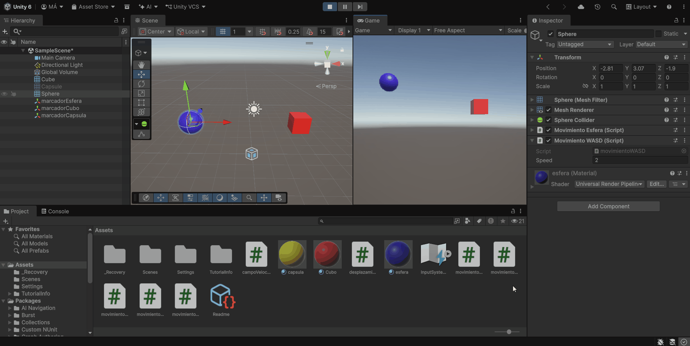

### Ejercicio 11

**Enunciado:** Adapta el movimiento en el ejercicio 10 para que el cubo se mueva hacia la posición de la esfera. Debes considerar que el avance no debe estar influenciado por cuánto de lejos o cerca estén los dos objetos.

**Archivo:** buscaEsfera.cs

**Descripción de lo realizado:**

Hemos utilizado `GameObject.Find()` para localizar la esfera en la escena. A partir de su posición y la del cubo, calculamos el vector dirección que une ambos objetos. Este vector se normaliza antes de aplicarlo al movimiento, de forma que su magnitud sea siempre 1. Así, la velocidad del cubo depende únicamente del valor de speed y no de la distancia a la que se encuentre la esfera.

**Gif de demostracion:**
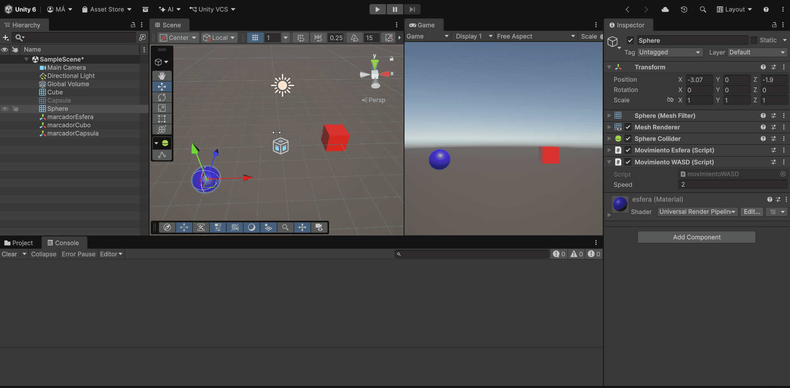

### Ejercicio 12

**Enunciado:** Adapta el movimiento en el ejercicio 11 de forma que el cubo avance mirando siempre hacia la esfera, independientemente de la orientación de su sistema de referencia. Para ello, el cubo debe girar de forma que el eje Z positivo apunte hacia la esfera . Realiza pruebas cambiando la posición de la esfera mediante las teclas awsd

**Archivo:** buscaEsferaRotacion.cs

**Descripción de lo realizado:**

Buscamos la esfera mediante GameObject.Find(). Después, utilizamos LookAt() para rotar el cubo de forma que su eje Z positivo apunte hacia la esfera. Una vez orientado correctamente, desplazamos el cubo hacia delante a lo largo de su eje Z local, consiguiendo que avance continuamente en dirección a la esfera.

**Gif de demostracion:**
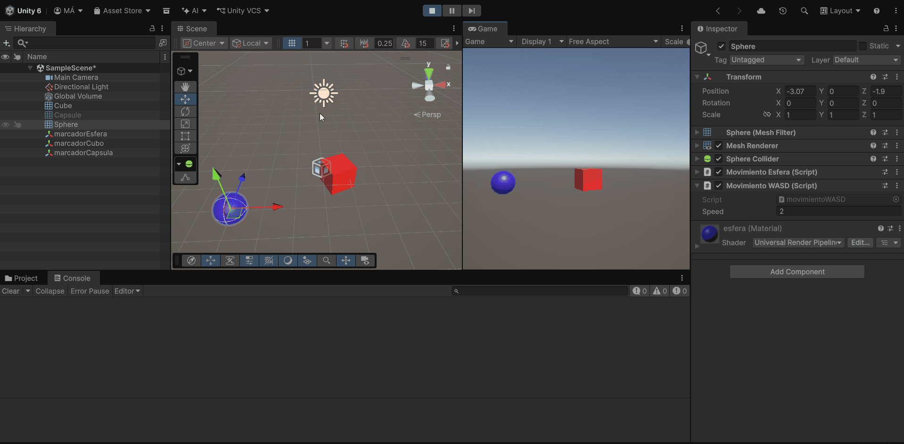

### Ejercicio 13

**Enunciado:** Utilizar el eje “Horizontal” para girar el objetivo y que avance siempre en la dirección hacia adelante.

**Archivo:** controlGiroCubo.cs

**Descripción de lo realizado:**

Se utiliza `Input.GetAxis("Horizontal")` para obtener la entrada horizontal del usuario y convertirla en una rotación alrededor del eje Y del cubo mediante `transform.Rotate().` El valor se multiplica por 500.0f y por `Time.deltaTime` para controlar la velocidad de giro de forma independiente a los FPS.  
Al mismo tiempo, el cubo se desplaza continuamente hacia delante utilizando `transform.Translate()` sobre su eje Z positivo, con una velocidad determinada por la variable speed. De esta forma, al girar el cubo también cambia la dirección en la que continúa avanzando. Además, `Debug.DrawRay()` dibuja un rayo rojo en la dirección de `transform.forward`, permitiendo visualizar en la escena hacia dónde está orientado y moviéndose el cubo.

**Gif de demostracion:**
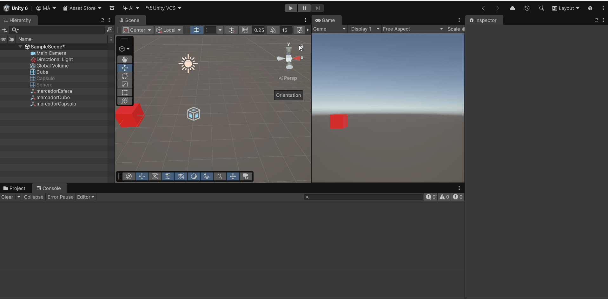
