# Practica 3 Interfaces Inteligentes

## Ejercicios físicas 3D: Situaciones

Las respuestas distinguen las observaciones realizadas de la explicación teórica. Se supone que los cuerpos dinámicos tienen `Use Gravity` activado, no presentan restricciones de movimiento y disponen de colliders compatibles. El resultado concreto de los impactos depende también de la posición inicial, la velocidad, los materiales y la geometría de contacto.

### Situación 1

**Enunciado:** El plano no es un objeto físico. El cubo es un objeto físico y la esfera no. En este caso, el plano y la esfera sólo tendrán collider, mientras que el cubo debe tener Rigidbody.

**Respuesta:** El cubo permanece prácticamente en reposo sobre el plano. La gravedad actúa sobre su Rigidbody, pero el contacto con el collider del plano impide que lo atraviese. Las pequeñas variaciones de posición observadas, del orden de 10⁻⁷ unidades, son compatibles con los ajustes numéricos de la simulación y no representan un desplazamiento apreciable.

La esfera permanece suspendida en su posición inicial porque carece de Rigidbody y, por tanto, la gravedad no modifica su posición. Sin embargo, su collider sigue participando en la detección de colisiones y puede actuar como obstáculo para el cubo.

**Gif de demostracion:**
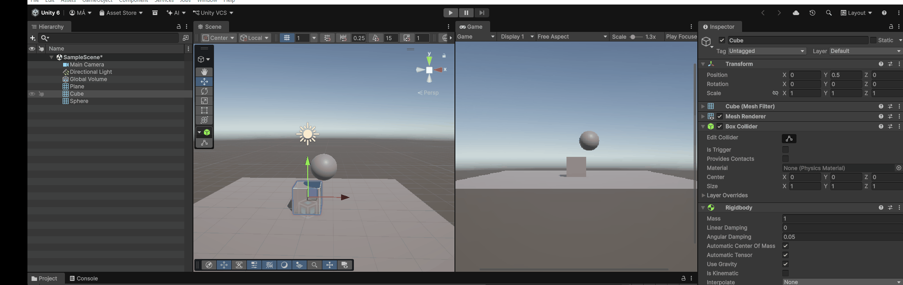

### Situación 2

**Enunciado:** El plano no es un objeto físico. El cubo es un objeto físico y la esfera también. En este caso, el plano sólo tendrán collider, mientras que el cubo y la esfera deben tener Rigidbody.

**Respuesta:** El cubo se mantiene inicialmente apoyado sobre el plano. La esfera cae por efecto de la gravedad y, si su trayectoria intersecta el cubo, se produce una colisión que puede modificar el movimiento de ambos cuerpos. El collider del plano impide que los objetos lo atraviesen y permite que se apoyen sobre él.

La presencia del collider permite el contacto, pero no garantiza que la esfera ruede, esta rueda fruto del impacto con el cubo.

**Gif de demostracion:**
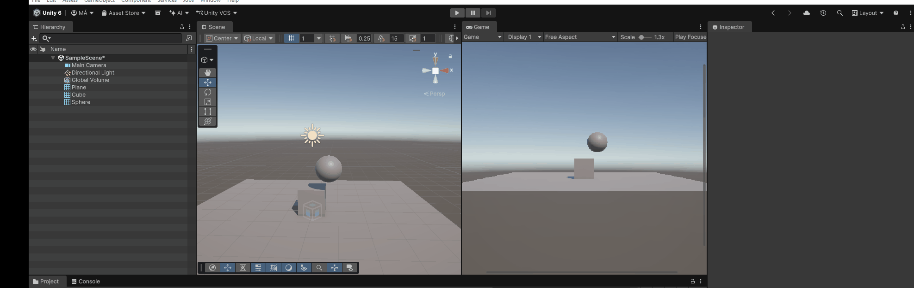

### Situación 3

**Enunciado:** El plano no es un objeto físico. El cubo es un objeto físico y la esfera es cinemática. En este caso, el plano sólo tendrán collider, mientras que el cubo y la esfera deben tener Rigidbody esta última cinemático.

**Respuesta:** La esfera permanece en su posición inicial porque su Rigidbody cinemático no es desplazado por la gravedad, las fuerzas ni los impactos. Su  motor de físicas queda desactivado, y su control queda delegado a su transform

No obstante, la esfera sigue participando en las interacciones físicas: su collider puede impedir el paso del cubo en caso de que este tuviera físicas.

**Gif de demostracion:**
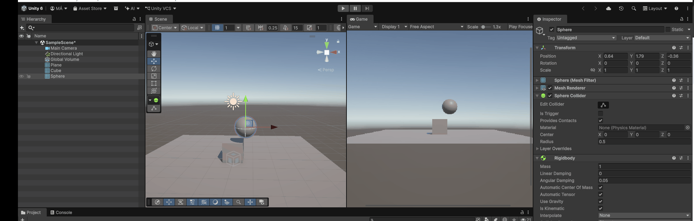

### Situación 4

**Enunciado:** El plano es un objeto físico. El cubo es un objeto físico y la esfera es física. En este caso, todos los objetos deben tener Rigidbody.

**Respuesta:** Al activar la gravedad en los tres cuerpos, todos caen si no existe otro soporte que los sostenga. El plano deja de actuar como una superficie fija, ya que también es un cuerpo dinámico.

**Gif de demostracion:**
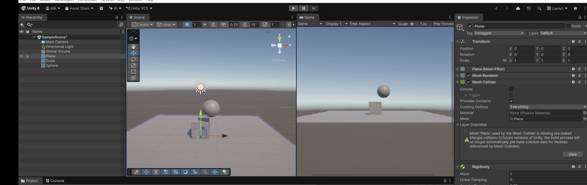

### Situación 5

**Enunciado:** El plano es un objeto cinemático. El cubo es un objeto físico y la esfera es física con 10 veces más masa que el cubo. En este caso, todos los objetos deben tener Rigidbody.

**Respuesta:** El plano permanece fijo. El cubo se apoya sobre él y la esfera cae por efecto de la gravedad. Al ser la masa del cubo inferior a la de la esfera es 10, la esfera presenta mayor inercia. Es importante tener en cuenta que esta mayor inercia en el choque se produce por la proporcion de masas.

**Gif de demostracion:**
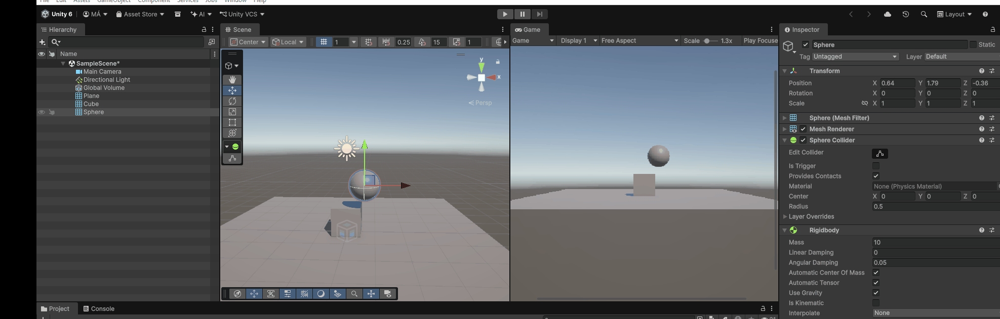

### Situación 6

**Enunciado:** El plano es un objeto cinemático. El cubo es un objeto físico y la esfera es física con 100 veces más masa que el cubo. En este caso, todos los objetos deben tener Rigidbody.

**Respuesta:** La configuración es equivalente a la anterior, pero al ser la masa de la esfera 100 veces mayor, en vez de rebotar, esta aparta al cubo, si el cubo tuviera una masa comparable, la esfera se comportaría exactamente igual que en el apartado 2.

**Gif de demostracion:**
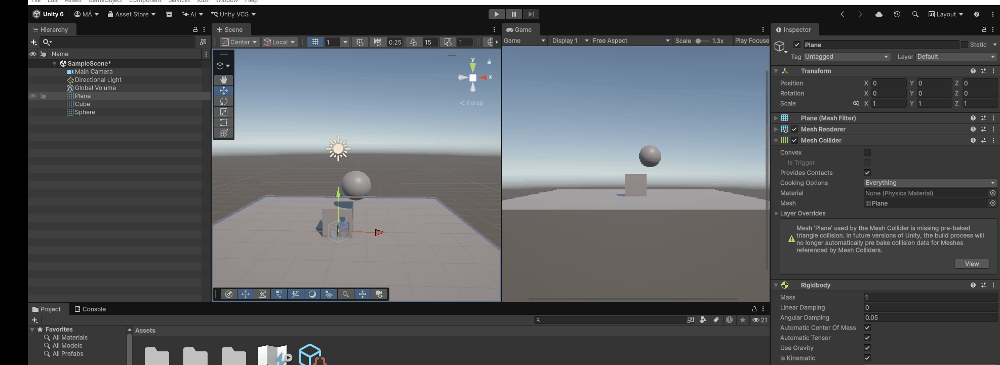

### Situación 7

**Enunciado:** El plano es un objeto físico. El cubo es un objeto físico y la esfera es física con fricción. En este caso, todos los objetos deben tener Rigidbody.

**Respuesta teórica:** Los tres objetos están sometidos a la gravedad y, si no hay un soporte adicional, caen. La fricción de la esfera se manifiesta cuando existe contacto con otro collider y se opone al deslizamiento relativo entre las superficies. Su efecto depende de los materiales de ambos colliders, de su combinación y de las condiciones de contacto. No actúa como una resistencia general al movimiento en el aire ni garantiza que una esfera que rueda termine deteniéndose.

Para configurar esta propiedad se debe crear un Physics Material, ajustar `Static Friction` y `Dynamic Friction` y asignarlo al campo `Material` del collider de la esfera.

### Situación 8

**Enunciado:** El plano es un objeto cinemático. El cubo es un objeto físico y la esfera no es física y es Trigger. En este caso, todos los objetos deben tener Rigidbody.

**Respuesta:** La esfera permanece en su posición inicial y no ofrece una superficie sólida: el cubo puede atravesar su volumen sin recibir una respuesta de choque por parte de ese trigger. Sin embargo, sí existe detección de solapamiento. Si se implementan los métodos correspondientes, pueden recibirse `OnTriggerEnter(Collider other)`, `OnTriggerStay(Collider other)` y `OnTriggerExit(Collider other)`.

### Situación 9

**Enunciado:** El plano es cinemático, el cubo es dinámico y la esfera tiene un Rigidbody dinámico y un Collider con `Is Trigger` activado. Todos los objetos tienen Rigidbody.

**Respuesta:** La esfera cae por efecto de la gravedad, ya que `Is Trigger` no desactiva el comportamiento dinámico de su Rigidbody. Su collider detecta solapamientos, pero no genera una respuesta física de contacto. Por ello, si este es su único collider, la esfera atraviesa el cubo y el plano cuando su trayectoria intersecta sus volúmenes, y continúa cayendo.

**Gif de demostracion:**
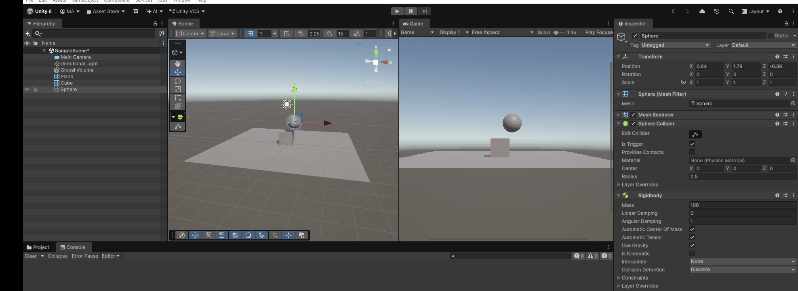

## Ejercicios scripts: Físicas

### Ejercicio 1

**Enunciado:** Crea un script que permita mover una cápsula mediante los ejes Horizontal y Vertical, con una velocidad configurable desde el Inspector. Realiza el desplazamiento mediante su Rigidbody y sincronízalo con la actualización de la física.

**Archivo:** Ejercicio1.cs

**Descripción de lo realizado:**

Se obtiene el Rigidbody de la cápsula mediante `GetComponent<Rigidbody>()` en `Start()`. En `Update()` se leen los ejes `Horizontal` y `Vertical` con `Input.GetAxisRaw()` y se construye un vector de movimiento sobre el plano XZ. En `FixedUpdate()` se utiliza `Rigidbody.MovePosition()` para actualizar la posición, multiplicando la dirección por la variable pública `speed` y por `Time.fixedDeltaTime`. Así, la lectura de la entrada queda separada de la actualización física y el desplazamiento se escala según el intervalo de simulación.

**Gif de demostracion:**
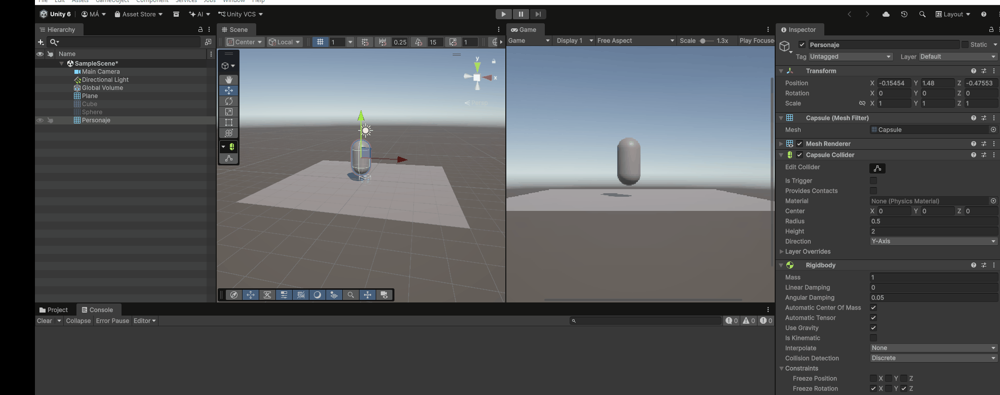

### Ejercicio 2

**Enunciado:** Detecta las colisiones del personaje con los objetos de la escena. Muestra en consola el nombre del objeto con el que colisiona y cambia su color de forma aleatoria, exceptuando el plano.

**Archivo:** Ejercicio2.cs

**Descripción de lo realizado:**

Se implementa `OnCollisionEnter(Collision collision)` para gestionar el inicio de cada colisión. El nombre del objeto se muestra mediante `Debug.Log()` y se obtiene su componente Renderer con `GetComponent<Renderer>()`. Si el componente existe y el objeto no se llama `Plane`, se modifica el color de su material utilizando `Random.ColorHSV()`. La comprobación del Renderer evita acceder a un componente inexistente y la exclusión por nombre mantiene el color del plano.

**Gif de demostracion:**
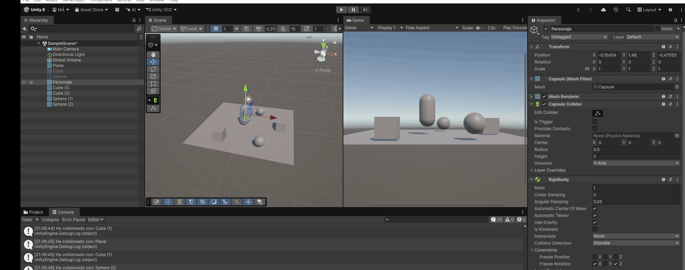

### Ejercicio 3

**Enunciado:** Crea una zona trigger que cambie el color de los objetos al entrar y restaure su color al salir. Añade una interacción que notifique el daño recibido por el personaje y acumule su valor al abandonar la zona.

**Archivo:** ejercicio3color.cs y ejercicio3daño.cs

**Descripción de lo realizado:**

En `ejercicio3color.cs` se utilizan `OnTriggerEnter(Collider collision)` y `OnTriggerExit(Collider collision)` para detectar la entrada y la salida del volumen. Al entrar, se guarda el color original del objeto y se cambia a verde; al salir, se recupera el color almacenado. El cambio se aplica únicamente a objetos con Renderer cuyo nombre sea distinto de `Plane`. El script conserva un único color original, por lo que esta solución está planteada para la interacción de un objeto cada vez.

En `ejercicio3daño.cs` se comprueba que el objeto detectado se llame `Personaje`. Al entrar se muestra un mensaje con el valor de la variable pública `daño`, inicialmente 10. Al salir se incrementa `dañoRecibido` con esa cantidad. El registro se realiza en el script de la zona; no se modifica un componente de salud del personaje. Al tratarse de un trigger, la detección no produce una respuesta física de choque.

**Gif de demostracion:**
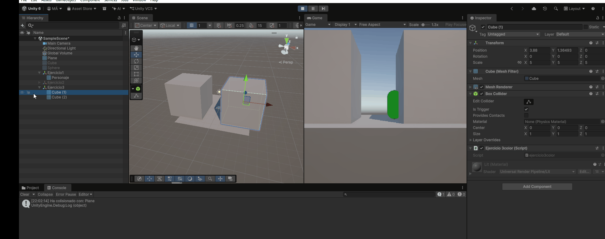

### Ejercicio 4

**Enunciado:** Organiza los objetos de la escena en capas y configura la matriz de colisiones para controlar qué grupos de objetos pueden interactuar físicamente.

**Archivo:** No hay archivo de script; se utilizan los ajustes del proyecto y las capas de los objetos.

**Descripción de lo realizado:**

Se han definido las capas `Jugador`, `Enemigo` y `Recolectable`, asignando a los objetos la capa correspondiente desde el Inspector. A continuación, en `Edit > Project Settings > Physics`, se utiliza `Layer Collision Matrix` para configurar las interacciones entre las distintas capas. Cada casilla permite habilitar o deshabilitar la interacción del par de capas asociado, sin tener que programar un filtro individual para cada objeto. El GIF muestra la configuración de esta matriz y la asignación de la capa `Enemigo` a uno de los objetos.

**Gif de demostracion:**
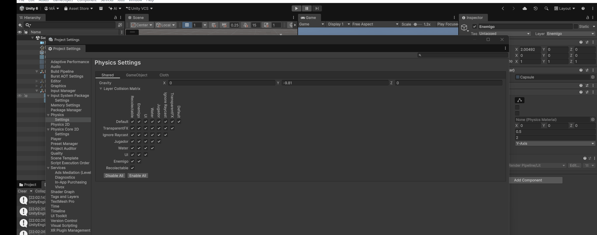

### Ejercicio 5

**Enunciado:** Crea un script que aplique un impulso a una esfera al pulsar la tecla X. La intensidad del impulso debe poder modificarse desde el Inspector.

**Archivo:** Ejercicio5.cs

**Descripción de lo realizado:**

En `Start()` se obtiene el Rigidbody de la esfera. En `Update()` se detecta la pulsación de X con `Input.GetKeyDown(KeyCode.X)` y se aplica `Rigidbody.AddForce(Vector3.right * fuerza, ForceMode.Impulse)`. El impulso actúa en la dirección positiva del eje X mundial y su intensidad se controla mediante la variable pública `fuerza`, inicialmente 10. Al utilizar `GetKeyDown()`, se aplica un impulso por pulsación. La variación de velocidad resultante depende de la masa del Rigidbody.

**Gif de demostracion:**
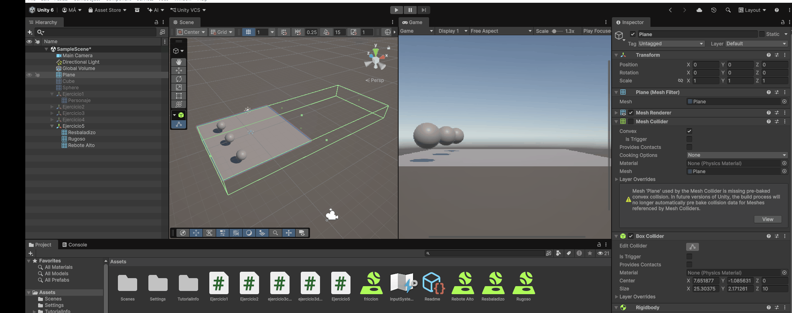

### Ejercicio 6

**Enunciado:** Desplaza un objeto hacia un cilindro con una velocidad independiente de la distancia al objetivo. Detecta la proximidad de un obstáculo y cambia su color a rojo cuando la distancia sea inferior a una unidad.

**Archivo:** ejercicio6.cs

**Descripción de lo realizado:**

En `Start()` se localizan el objetivo `Cylinder` y el obstáculo `Cube (1)` mediante `GameObject.Find()`. En `Update()` se calcula la dirección hacia el objetivo restando ambas posiciones y normalizando el resultado. El objeto avanza modificando `transform.position`, con una velocidad de 5 unidades por segundo escalada mediante `Time.deltaTime`. La normalización evita que la velocidad aumente con la distancia al objetivo.

Además, se calcula la distancia al centro del obstáculo mediante `Vector3.Distance()`. Si es inferior a una unidad y el obstáculo tiene Renderer, su material cambia a rojo. Esta detección se basa en la proximidad entre posiciones, no en un evento de colisión ni en el tamaño de los colliders. El script no implementa una maniobra para esquivar el obstáculo, no restaura su color al alejarse y no limita el avance al alcanzar el objetivo, por lo que puede oscilar alrededor de él. El movimiento se realiza mediante Transform, sin utilizar el Rigidbody.

**Gif de demostracion:**
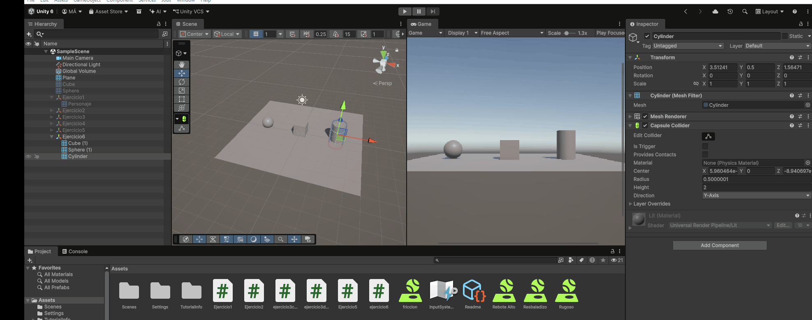
