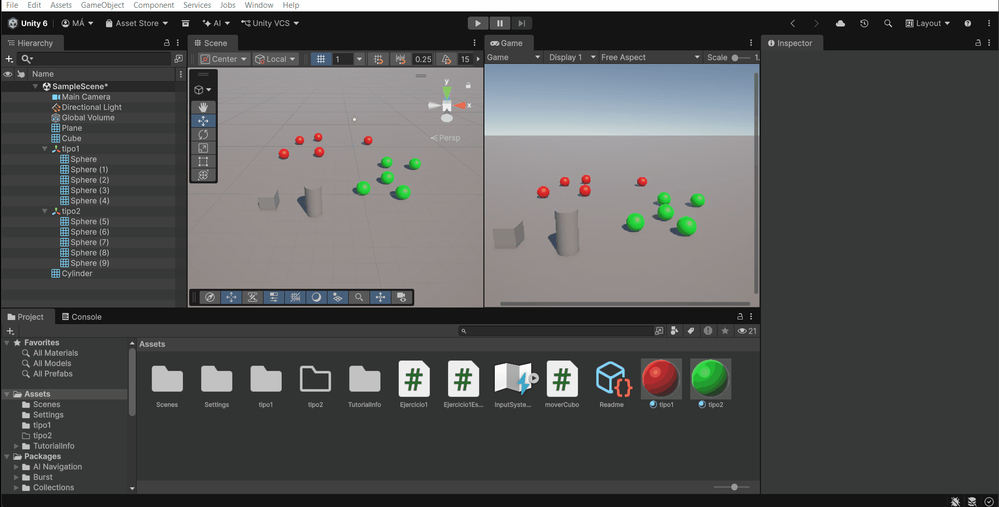
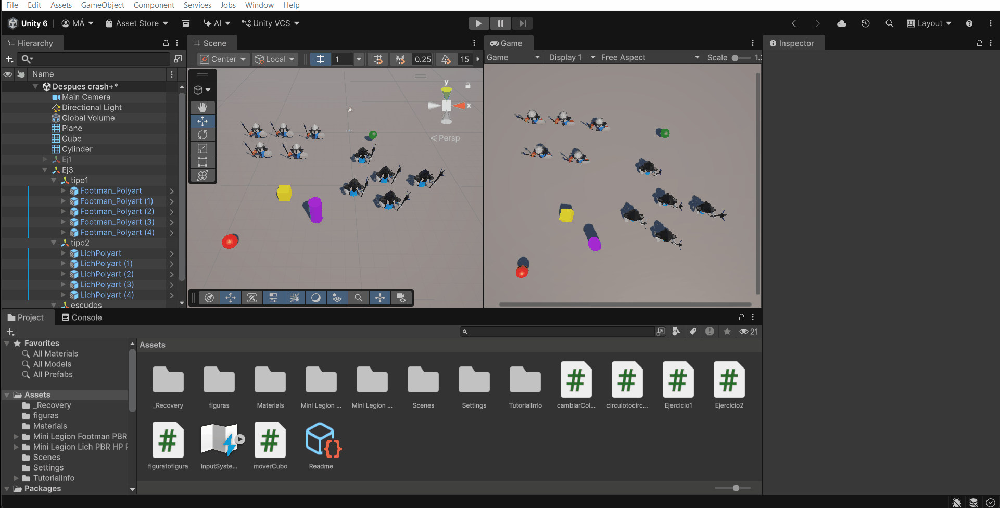
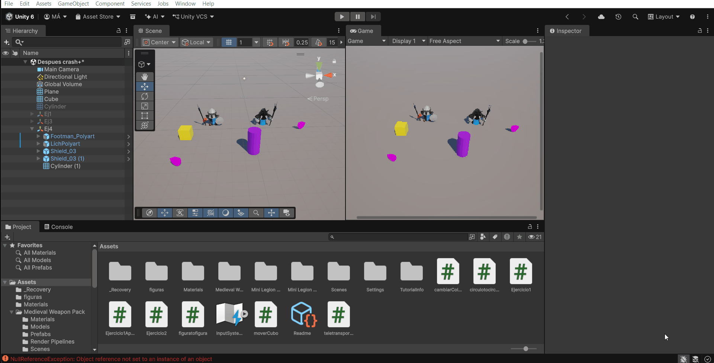
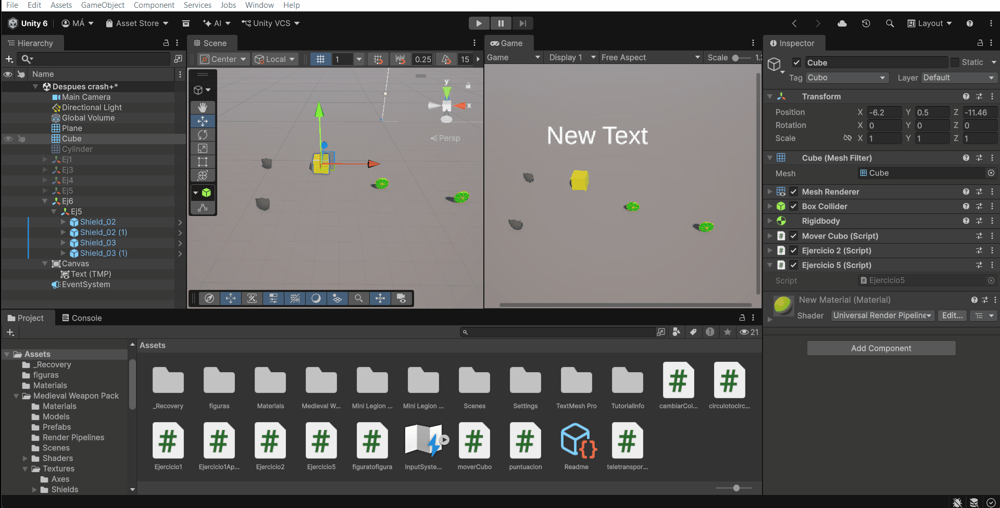
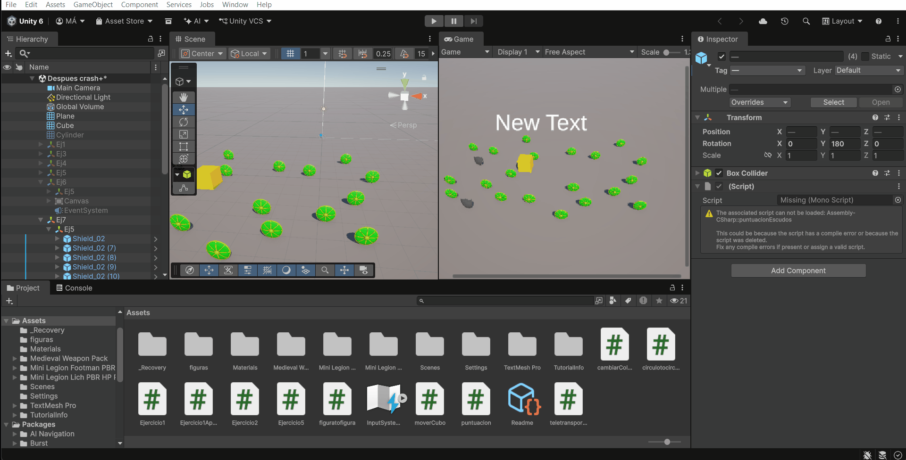
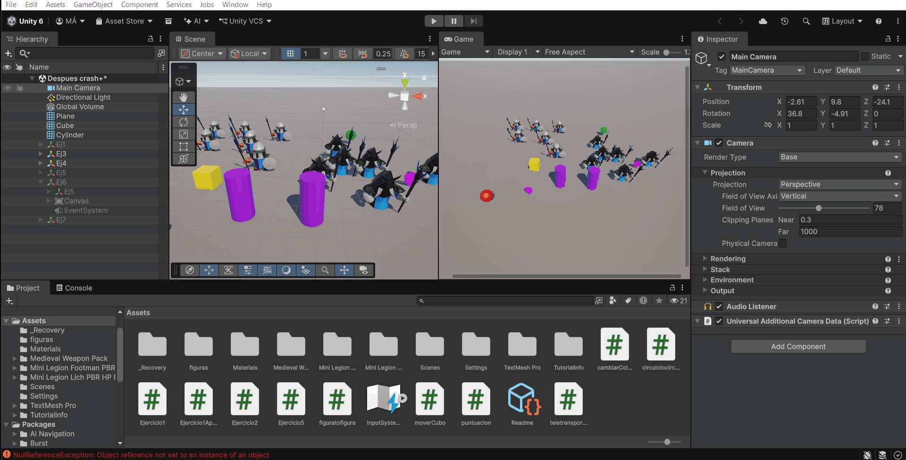

# Practica 4 Interfaces Inteligentes

## Ejercicios scripts: Patrón observador

### Ejercicio 1

**Enunciado:** Crea una escena con 5 esferas, rojas que las etiquetas de tipo 1, y verdes de tipo 2. Añade un cubo y un cilindro. Crea la siguiente mecánica: cuando el cubo colisiona con el cilindro, las esferas de tipo 1 se dirigen hacia una de las esferas de tipo 2 que fijes de antemano y las esferas de tipo 2 se desplazan hacia el cilindro.

**Archivo:** Ejercicio1.cs, circulotocirculo.cs y moverCubo.cs

**Descripción de lo realizado:**

El cilindro utiliza `OnCollisionEnter()` para detectar el contacto con el cubo mediante la etiqueta `Cubo` y emitir el evento `OnContactoConCubo`. Las esferas se suscriben a este evento según su etiqueta: las de tipo 1 se desplazan hacia el objetivo seleccionado en el Inspector y las de tipo 2 hacia el cilindro. El desplazamiento utiliza una dirección normalizada y se multiplica por `velocidad` y `Time.deltaTime`. Así, el notificador comunica la colisión y cada grupvo responde con su movimiento correspondiente.

**Gif de demostracion:**

### Ejercicio 2

**Enunciado:** Sustituye los objetos geométricos por [humanoides  que encontrarás en el enlace](https://assetstore.unity.com/packages/3d/characters/humanoids/fantasy/mini-legion-footman-pbr-hp-polyart-86576) y [en este enlace](https://assetstore.unity.com/packages/3d/characters/humanoids/fantasy/mini-legion-lich-pbr-hp-polyart-91497) 

**Archivo:** Ejercicio1.cs, figuratofigura.cs y moverCubo.cs

**Descripción de lo realizado:**

Se han incorporado los modelos de Mini Legion Footman y Mini Legion Lich para sustituir las figuras geométricas por humanoides, manteniendo la separación por etiquetas de tipo 1 y tipo 2. El script `figuratofigura.cs` conserva la suscripción al evento de contacto con el cilindro y adapta el desplazamiento a `Rigidbody.MovePosition()` en `FixedUpdate()`. Además, utiliza `Quaternion.LookRotation()` para orientar los humanoides hacia su destino.

### Ejercicio 3

**Enunciado:** Adapta la escena anterior para que existan humanoides de tipo 1 y de tipo 2, así como diferentes tipos de escudos, tipo 1 y tipo 2:

- Cuando el cubo colisiona con cualquier humanoide  tipo 2,  los del grupo 1 se acercan a un escudo seleccionado. Cuando el cubo toca cualquier humanoide del grupo 1 se dirigen hacia los escudos del grupo 2 que serán objetos físicos. Si algún humanoide a colisiona con uno de ellos debe cambiar de color. 

**Archivo:** Ejercicio2.cs, figuratofigura.cs, cambiarColorEscudo.cs y moverCubo.cs

**Descripción de lo realizado:**

El script `Ejercicio2.cs` distingue las colisiones con las etiquetas `tipo 1` y `tipo 2` y emite `OnContactoTipo1` u `OnContactoTipo2`. Los humanoides de tipo 1 escuchan el contacto con el grupo 2 y los de tipo 2 el contacto con el grupo 1. Al recibir el evento, establecen como destino el escudo asignado en el Inspector y avanzan mediante su Rigidbody. El script `cambiarColorEscudo.cs` cambia el color del Renderer del objeto que lo tiene asociado al producirse una colisión, utilizando `Random.ColorHSV()`.

**Gif de demostracion:**

### Ejercicio 4

**Enunciado:** Cuando el cubo se aproxima al objeto de referencia, los humanoides del grupo 1 se teletransportan a un [escudo objetivo](https://assetstore.unity.com/packages/3d/props/weapons/shield-61351#content) que debes fijar de antemano.Los humanoides del grupo 2 se orientan hacia un objeto ubicado en la escena con ese propósito. 

**Archivo:** Ejercicio1Aprox.cs y teletransporte.cs

**Descripción de lo realizado:**

Se utiliza una zona trigger para detectar la aproximación del cubo. Cuando entra un objeto con la etiqueta `Cubo`, `Ejercicio1Aprox.cs` emite el evento `OnTriggerCubo`. Los humanoides de tipo 1 responden asignando a `transform.position` la posición del escudo objetivo. Los de tipo 2 calculan la dirección hacia el segundo objeto de referencia y modifican su rotación mediante `Quaternion.LookRotation()`, sin desplazarse hacia él. Ambos objetivos se asignan desde el Inspector.

**Gif de demostracion:**

### Ejercicio 5

**Enunciado:** Implementar la mecánica de recolectar escudos en la escena que actualicen la puntuación del jugador. Los escudos de tipo 1 suman 5 puntos y los de tipo 2 suman 10. Mostrar la puntuación en la consola.

**Archivo:** Ejercicio5.cs

**Descripción de lo realizado:**

El cubo detecta los escudos mediante `OnTriggerEnter()`. Si el objeto tiene la etiqueta `tipo 1`, suma 5 puntos, y si tiene la etiqueta `tipo 2`, suma 10. Después se elimina el escudo con `Destroy()` para que no pueda recogerse de nuevo. La puntuación se almacena en la variable estática `points`, que se reinicia en `Start()`. En la versión actual del script, la puntuación se comunica mediante el evento `OnPuntuacion` para mostrarla en la interfaz del ejercicio siguiente; no se incluye una llamada a `Debug.Log()` para imprimirla en consola.

### Ejercicio 6

**Enunciado:** Partiendo del script anterior crea una interfaz que muestre la puntuación que va obteniendo el cubo.  &#x20;

**Archivo:** Ejercicio5.cs y puntuacion.cs

**Descripción de lo realizado:**

El script `puntuacion.cs` se suscribe al evento `OnPuntuacion` del recolector. Cada vez que se produce la notificación, obtiene el componente `TextMeshProUGUI`, consulta el valor de `Ejercicio5.points` y actualiza el texto con `SetText()`. De esta forma, la lógica de recogida comunica el cambio y el componente de interfaz se encarga de mostrar la puntuación.

**Gif de demostracion:**

### Ejercicio 7

**Enunciado:** Partiendo de los ejercicios anteriores, implementa una mecánica en la que cada 100 puntos el jugador obtenga una recompensa que se muestre en la UI.

**Archivo:** Ejercicio5.cs y puntuacion.cs

**Descripción de lo realizado:**

Después de actualizar la puntuación, se comprueba si `points % 100 == 0` y la puntuación es distinta de cero. Si se cumple esta condición, se emite `OnRecompensa`. La interfaz está suscrita a este evento y sustituye el texto de puntuación por un mensaje de felicitación con los puntos alcanzados. La comprobación se activa cuando el total coincide exactamente con un múltiplo de 100; no detecta un umbral que se haya sobrepasado sin coincidir con él.

**Gif de demostracion:**

### Ejercicio 8

**Enunciado:** Genera una escena que incluya elementos que se ajusten a la escena del prototipo y alguna de las mecánicas anteriores.

**Archivo:** Escena del prototipo y scripts de las mecánicas anteriores.

**Descripción de lo realizado:**

Se presenta una escena adaptada al prototipo que incorpora elementos visuales y reutiliza las mecánicas desarrolladas en los ejercicios anteriores. El GIF muestra el resultado de la escena y su funcionamiento.

**Gif de demostracion:**

### Ejercicio 9

**Enunciado:** Implementa el ejercicio 3 siendo el cubo un objeto físico.

**Archivo:** moverCubo.cs, Ejercicio2.cs, figuratofigura.cs y cambiarColorEscudo.cs

**Descripción de lo realizado:**

El cubo ya era un objeto físico desde el principio, por lo que el ejercicio 3 se implementó directamente con esta condición. Dispone de Rigidbody y collider, y el script `moverCubo.cs` obtiene ese Rigidbody mediante `GetComponent<Rigidbody>()`. El movimiento se realiza en `FixedUpdate()` utilizando `Rigidbody.MovePosition()`, con una dirección normalizada y un desplazamiento proporcional a `Time.fixedDeltaTime`. Las interacciones con los humanoides se detectan mediante `OnCollisionEnter()`. Por tanto, no ha sido necesario crear una variante adicional: la mecánica del ejercicio 3 ya utiliza el cubo físico solicitado.

**Gif de demostracion:**

